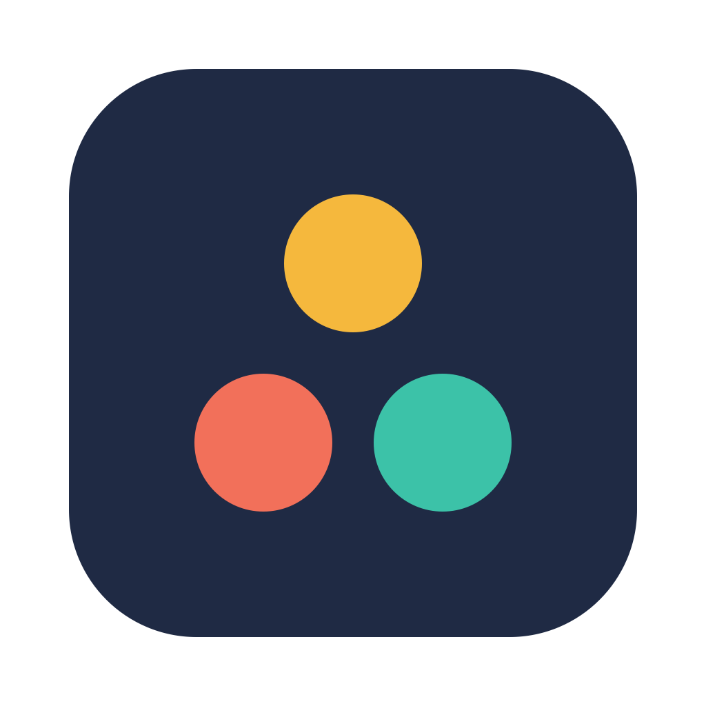
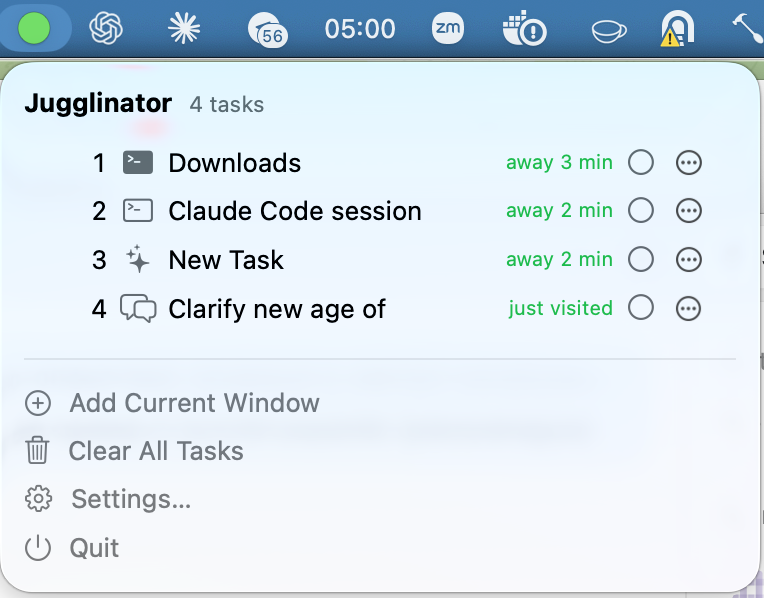

<p align="center"></p>

<h1 align="center">Jugglinator</h1>

<p align="center">
One hotkey to cycle through your parallel AI chats on macOS:<br>
Claude chats, Claude Code sessions, ChatGPT threads, Chrome tabs and Terminal tabs.<br>
Like ⌘Tab, but for tasks instead of apps.
</p>

<p align="center">
  <a href="https://github.com/sefimov/jugglinator/releases/latest/download/Jugglinator.app.zip"></a>
  <br>
  <sub>Free and open source (MIT) · <a href="https://sefimov.github.io/jugglinator/">Website</a>. Not notarized yet: on first launch see <a href="#first-launch">First launch</a>.</sub>
</p>

<p align="center"></p>

---

## The problem

You have three Claude Code sessions working on three branches, a ChatGPT thread where you are drafting a spec, a Claude chat with a design review, a Terminal tab with the tests, and a Chrome tab with the docs. Each of them is one *task*. ⌘Tab shows you apps, not tasks. Window switchers show you windows, but two Claude Code sessions are the same window, and two ChatGPT threads look identical in a list. So you click around, lose track of which agent has been waiting for you for an hour, and forget the one that has finished.

Jugglinator is a macOS menu bar app that keeps the list of those tasks and cycles through them with a hotkey. On each switch it opens exactly the bound thing: the chat, the session, the thread, the tab. A colored circle in the menu bar shows the task you have neglected the longest.

## What it does

- **One hotkey, next task.** ⌃⇥ goes to the next task, ⌃⇧⇥ to the previous one, in a fixed 1→2→3→1 order. A small card shows the task number, title and how long you were away. It does not take focus.
- **Add the current window as a task.** ⌃⌥⇥ in any window makes it a task; the same hotkey in a window that is already a task removes it. No typing, no forms.
- **Deep bindings, not just window titles.** Jugglinator reopens the exact chat or tab, even after the app was restarted:
  - Claude desktop: the chat by its UUID (`claude://` link).
  - Claude Code (the Code tab in Claude desktop): the session by its id, with the session title as the task name.
  - ChatGPT desktop: the thread by its id, found through ChatGPT's local thread index.
  - Google Chrome: the tab by id, then by URL.
  - Terminal.app: the window and tab by tty.
  - Any other app (Cursor, VS Code, iTerm2, Grok, Safari…): the window by title.
- **Mark a task done** with ⌃§ (⌃` on an ANSI keyboard); done tasks are skipped in the cycle. Press again to bring it back, or clear them all with "Delete Done Tasks" in the menu.
- **The menu bar circle** turns from green to yellow, orange and red as the longest-waiting task waits 10, 30 and 60 minutes. Hover it to see which task that is.
- **An MCP server for your AI assistant.** Turn on "MCP server" in Settings and Claude Desktop, Claude Code or ChatGPT (Codex) can list your tasks, switch to one, add the current window, mark tasks done and edit notes, see [MCP server](#mcp-server).
- **Private by design.** No account, no network, no analytics. Jugglinator reads a few local files (ChatGPT's thread index, Claude Code session titles) and writes its own `tasks.json`. No third-party dependencies, about 3 MB on disk.
- **12 languages:** Arabic, Chinese (Simplified), English, French, German, Hindi, Italian, Japanese, Korean, Portuguese (Brazil), Russian, Spanish. Switch in Settings → Language without a restart.

## Who it is for

- Developers running several Claude Code, Codex or other agent sessions in parallel and switching between them while they work.
- Anyone who keeps a handful of long-running ChatGPT or Claude conversations open as "projects" and wants to get back to the right one in one keystroke.
- People with a million tabs and windows who want a short list of the ones that matter *today*, and a reminder of which one they have been ignoring.

## Install

**Download.** Get [Jugglinator.app.zip](https://github.com/sefimov/jugglinator/releases/latest/download/Jugglinator.app.zip) from the latest release, unzip, move `Jugglinator.app` to Applications. Requires macOS 14 or later. The release build is for Apple silicon; on an Intel Mac build from source.

**Build from source.** Only the Command Line Tools with Swift 6.x are needed; full Xcode is not required.

```sh
git clone https://github.com/sefimov/jugglinator.git && cd jugglinator
scripts/bundle.sh                       # build, sign and self-test build/Jugglinator.app
ditto build/Jugglinator.app /Applications/Jugglinator.app
open /Applications/Jugglinator.app          # a colored circle appears in the menu bar
```

### First launch

1. Open `Jugglinator.app`. macOS says it cannot verify the developer: open System Settings → Privacy & Security and click "Open Anyway". Or run `xattr -dr com.apple.quarantine /Applications/Jugglinator.app` once.
2. On the first binding Jugglinator asks for Accessibility and, for Chrome and Terminal, Automation permissions, see [Permissions](#permissions). It asks only when needed and works with less if you decline.
3. Optional: turn on "Launch at login" in Settings.

### Upgrading from Juggler

Jugglinator is the app formerly called Juggler (renamed on 2026-10-29 to avoid a clash with an unrelated app of the same name). On first launch it copies your tasks, hotkeys and language choice from the old `~/Library/Application Support/Juggler/` folder and the old defaults domain; nothing is deleted there. Two things macOS ties to the bundle id cannot be carried over: grant the Accessibility and Automation permissions again when asked, and turn "Launch at login" back on in Settings. Then quit the old Juggler.app and delete it.

### Getting started

1. Open a chat in Claude, a session on the Code tab in Claude, a chat in ChatGPT, a tab in Chrome, a Terminal window.
2. Press ⌃⌥⇥ or choose "Add Current Window" in the Jugglinator menu. Tasks are added only from the current window: there is no "New task" field in the menu. Pressing ⌃⌥⇥ again in a window that is already a task removes it, see "Add or remove the current window".
3. Repeat for the other tasks.
4. Cycle forward with ⌃⇥, backward with ⌃⇧⇥.

| Hotkey | Action |
|---|---|
| ⌃⇥ | Next task |
| ⌃⇧⇥ | Previous task |
| ⌃⌥⇥ | Add or remove the current window |
| ⌃§ (⌃` on ANSI keyboards) | Mark done / back to work |

All hotkeys can be changed in Settings → Hotkeys. While Jugglinator is running, ⌃⇥ and ⌃⇧⇥ no longer switch tabs in Chrome, Safari, Terminal, VS Code or Xcode; reassign them if that gets in the way.

## How it compares

| | What it switches | Jumps to a specific Claude Code session or ChatGPT thread | Shows what you have neglected |
|---|---|---|---|
| ⌘Tab, Stage Manager, Spaces | apps, windows, desktops | no | no |
| AltTab, Contexts, rcmd, Witch | windows by title | no: two sessions are the same window | no |
| tmux, iTerm2 profiles | terminal panes | terminal only | no |
| Raycast / Alfred window commands | windows | no | no |
| **Jugglinator** | a short list of *tasks* you chose | yes: chat, session, thread, tab, tty | yes: menu bar circle, "away N min" |

Jugglinator is not a replacement for ⌘Tab or a window manager. It is a task list for the two to ten things you are actively juggling, with a hotkey that always lands on the right one.

## FAQ

**Does it work with the ChatGPT and Claude desktop apps, or only in the browser?** With the desktop apps. Claude chats and Claude Code sessions are opened by `claude://` links, ChatGPT threads by `codex://` links. A chat open in a Chrome tab is bound as a Chrome tab, which also works.

**Can I bind a Cursor, VS Code, iTerm2 or Safari window?** Yes, as a window: Jugglinator remembers the app and the window title and raises that window. Deep bindings (tab, session, thread, tty) exist for Chrome, Claude, Claude Code, ChatGPT and Terminal.app.

**Does Jugglinator send anything anywhere?** No. It has no network code. It reads ChatGPT's local `session_index.jsonl` and Claude Code's local session files to learn thread ids and titles, and stores its own list in `~/Library/Application Support/Jugglinator/tasks.json`.

**Why does macOS say the developer cannot be verified?** The release is ad-hoc signed and not notarized with an Apple Developer ID yet. "Open Anyway" in System Settings or the `xattr` command above fixes it once. The source is here if you prefer to build it yourself.

**Does it work with the Russian or other non-US keyboard layouts?** Yes. Hotkeys are bound to physical keys, not characters, so ⌃⇥ and ⌃§ work in any layout.

**Is it on Homebrew or the Mac App Store?** No. Homebrew casks now require notarized apps, and the App Store sandbox does not allow the Accessibility and Apple Events access Jugglinator needs. Download the zip or build from source.

**Can my AI assistant drive Jugglinator?** Yes, through the built-in [MCP server](#mcp-server): turn it on in Settings and add `Jugglinator --mcp` to Claude Desktop, Claude Code or Codex. The assistant can then list your tasks, switch to one, add the current window, mark tasks done and edit notes.

**Where do I report a bug or ask for an app to be supported?** [GitHub issues](https://github.com/sefimov/jugglinator/issues). Say which app and what the window title looks like.

## MCP server

Jugglinator has a built-in [MCP](https://modelcontextprotocol.io) (Model Context Protocol) server, so an AI assistant can work with the same task list you cycle through with ⌃⇥. It is off by default.

1. Jugglinator menu → "Settings…" → "MCP server" → turn on "Enable MCP server". The section then shows the exact snippets below with the path of your copy of Jugglinator, each with a Copy button.
2. Add the server to your assistant:

   - **Claude Desktop**: add to `~/Library/Application Support/Claude/claude_desktop_config.json` and restart Claude Desktop:
     ```json
     {
       "mcpServers": {
         "jugglinator": {
           "command": "/Applications/Jugglinator.app/Contents/MacOS/Jugglinator",
           "args": ["--mcp"]
         }
       }
     }
     ```
   - **Claude Code**:
     ```sh
     claude mcp add jugglinator -- /Applications/Jugglinator.app/Contents/MacOS/Jugglinator --mcp
     ```
   - **ChatGPT desktop / Codex**: add to `~/.codex/config.toml`:
     ```toml
     [mcp_servers.jugglinator]
     command = "/Applications/Jugglinator.app/Contents/MacOS/Jugglinator"
     args = ["--mcp"]
     ```
3. Ask the assistant to "list my Jugglinator tasks" or "switch to task 2".

Tools:

| Tool | What it does |
|---|---|
| `list_tasks` | Number, id, title, note, done mark, binding kind (`claudeChat`, `claudeCodeSession`, `chatGPTThread`, `chromeTab`, `terminalWindow`, `appWindow`), minutes since the last visit and which task is current (the frontmost window's task, otherwise the last visited one) |
| `switch_to_task` | Same as the ⌃⇥ cycle landing on the task: opens the binding, shows the card, records the visit. By `number` or `id` |
| `add_current_window` | Same as ⌃⌥⇥ in a window that is not a task yet: adds the frontmost window and makes it current. If the window already is a task, returns it |
| `mark_done`, `mark_in_progress` | Set or clear the done mark, with the same card as ⌃§ |
| `set_note` | Replace the "why / next" note (an empty string clears it) |

How it works: the running Jugglinator.app listens on a Unix socket, `~/Library/Application Support/Jugglinator/mcp.sock`. `Jugglinator --mcp` is the stdio process the assistant launches; it relays newline-delimited JSON-RPC between stdin/stdout and the socket, so the assistant talks to the app that owns the task list, not to a second copy of `tasks.json`. While Jugglinator is not running or the toggle is off, the relay still answers `initialize` and `tools/list` itself, and every tool call returns an error that says how to turn the server on; it reconnects on the next request once Jugglinator is up. Nothing leaves the Mac: there is no network transport.

Protocol: MCP revision 2025-06-18 (2025-03-26 and 2024-11-05 are accepted in `initialize`), tools only, implemented with Foundation JSON and no dependencies. The protocol logic is `Sources/JugglerCore/MCP/`, checked by `swift run JugglerChecks MCP`; the socket server, the relay and the settings section are `Sources/Jugglinator/MCP/`, exercised over a real socket by `Jugglinator --self-test`.

Trying it by hand, without an assistant:

```sh
# Jugglinator.app is running with "MCP server" on.
printf '%s\n' \
  '{"jsonrpc":"2.0","id":1,"method":"initialize","params":{"protocolVersion":"2025-06-18","capabilities":{},"clientInfo":{"name":"shell","version":"0"}}}' \
  '{"jsonrpc":"2.0","method":"notifications/initialized"}' \
  '{"jsonrpc":"2.0","id":2,"method":"tools/call","params":{"name":"list_tasks","arguments":{}}}' \
  | /Applications/Jugglinator.app/Contents/MacOS/Jugglinator --mcp
```

---

## Developer documentation

Everything below is for building, debugging and extending Jugglinator: [building and checks](#building-and-checks), [the .app bundle](#building-the-app), [hotkeys](#hotkeys) and [adding or removing the current window](#add-or-remove-the-current-window) in detail, [bindings](#bindings), [permissions](#permissions), [signing for development](#signing-the-jugglinator-dev-certificate), [`--probe-frontmost`](#debugging-bindings---probe-frontmost), [localization](#localization), [package layout](#package-layout) and [extension points](#extension-points-and-rules-for-ui-switch-bind-and-pack). The [MCP server](#mcp-server) is described above. Bundle id: `com.sefimov.jugglinator`.

## Building and checks

Only the Command Line Tools with Swift 6.x are needed; full Xcode is not required.

```sh
swift build                         # build all targets
swift run JugglerChecks             # logic checks: exit code 0 — all passed, 1 — failures
swift run JugglerChecks -v          # print every passed check
swift run JugglerChecks Core Bind   # run only the selected suites
swift run JugglerChecks --self-fail # deliberate failure: make sure the exit code is non-zero

swift run Jugglinator                   # run the menu bar app (without an .app)
swift run Jugglinator --self-test       # self-test of components without windows or permission prompts
swift run Jugglinator --probe-frontmost # JSON with the frontmost window context
swift run Jugglinator --mcp             # stdio MCP server, relayed to the running app (see "MCP server")
```

`swift run Jugglinator` is handy for debugging. But without an `.app`, macOS grants permissions to Terminal rather than Jugglinator, and launch at login does not work. For everyday use, build the `.app`.

## Building the .app

```sh
scripts/bundle.sh                                   # ad-hoc signing
JUGGLER_SIGN_IDENTITY="Jugglinator Dev" scripts/bundle.sh  # sign with your own certificate
scripts/bundle.sh --no-self-test                    # skip the self-test at the end
JUGGLER_VERSION=0.3.0 scripts/bundle.sh             # custom version (default 0.2.0)
```

What the script does:

1. Builds a release: `swift build -c release --product Jugglinator`.
2. Assembles `build/Jugglinator.app`. `Info.plist` comes from the `scripts/Info.plist` template:
   - `CFBundleIdentifier` — `com.sefimov.jugglinator`;
   - `CFBundleIconFile` — `AppIcon`; `Resources/AppIcon.icns` is copied into `Contents/Resources` (see "App icon");
   - `LSUIElement` — no Dock icon, menu bar only;
   - `LSMinimumSystemVersion` — 14.0;
   - `NSAppleEventsUsageDescription` — the explanation shown when asking to control Chrome and Terminal, translated in `InfoPlist.strings`;
   - `CFBundleDevelopmentRegion` — `en`, `CFBundleLocalizations` — the 12 languages from `Localization/*.lproj`, which are copied into `Contents/Resources`;
   - `CFBundleVersion` — the number of commits in `git`.
3. Validates `Info.plist` with `plutil -lint`.
4. Signs with the identity from `JUGGLER_SIGN_IDENTITY`, ad-hoc (`-`) by default.
5. Verifies the signature: `codesign --verify --strict --verbose=2`.
6. Runs `build/Jugglinator.app/Contents/MacOS/Jugglinator --self-test`.

Any failure stops the script with a non-zero exit code. The `build/` folder is not committed to `git`.

The self-test can also be run on its own:

```sh
build/Jugglinator.app/Contents/MacOS/Jugglinator --self-test; echo $?
```

It initializes the store, the composition root and the UI, SWITCH and BIND modules. It checks the "hotkey → switcher → card" chain, "⌃⌥ → add or remove the current window", removing the frontmost window's task and restoring it with a second ⌃⌥⇥, ⌃§ marking the task done and back, Carbon hotkey registration, and the `Info.plist` keys of the built `.app`. It shows no windows and requests no permissions. Exit code 0 means everything passed.

## Running

- `open build/Jugglinator.app` launches the built app. If Jugglinator is already running, quit it first: Jugglinator menu → "Quit".
- **Launch at login** is turned on in Jugglinator settings (menu → "Settings…"). It works only from the `.app`, and is most reliable when the app lives in `/Applications`:
  ```sh
  ditto build/Jugglinator.app /Applications/Jugglinator.app
  ```
  If macOS asks for confirmation, an "Open Login Items" button appears in Jugglinator settings.
- Data lives in `~/Library/Application Support/Jugglinator/tasks.json`, custom hotkeys in `hotkeys.json` next to it; `mcp.sock` next to them is the MCP server's socket while it is on.

## Hotkeys

| Action | Default | ANSI keyboard |
|---|---|---|
| Next task | ⌃⇥ | ⌃⇥ |
| Previous task | ⌃⇧⇥ | ⌃⇧⇥ |
| Add or remove current window | ⌃⌥⇥ | ⌃⌥⇥ |
| Mark done / back to work | ⌃§ | ⌃` |

- ⇥ is Tab (`kVK_Tab`), the same key on every keyboard type and layout.
- § is the physical key above Tab, to the left of 1. In the Russian layout it types `<`. The hotkey is bound to the key itself, not the character, so it works in both RU and EN layouts.
- Jugglinator detects the keyboard type (ISO with § or ANSI with `) and picks the "done" default accordingly.
- The hotkeys are global: while Jugglinator is running, ⌃⇥ and ⌃⇧⇥ no longer switch tabs in Chrome, Safari, Terminal, iTerm2, VS Code or Xcode, and ⌃§ / ⌃` is taken from them too (in VS Code ⌃` normally toggles the terminal). Reassign any of them in Settings → "Hotkeys" if that gets in the way.
- The switching order is fixed: 1→2→3→1. Tasks marked "done" are skipped. The current task is determined at the moment of the key press from the frontmost window or tab.
- **⌃⇥ in a window that is not a task** switches to a task window as usual (counting from the last active task); nothing is added. To add the window, press ⌃§ or ⌃⌥⇥.
- On each switch, a card with the number, title, note and "away N min" appears for a second or so. The card does not take focus and lets clicks through.
- **Reassigning:** Jugglinator settings → "Hotkeys". Click the field, then press the desired combination; Esc cancels, "Default" restores the default.
- `~/Library/Application Support/Jugglinator/hotkeys.json` stores only reassigned combinations. Defaults are computed at launch from the keyboard type. To reset everything, quit Jugglinator and delete this file.
- Global (Carbon) hotkeys work only while the app is running. The hotkeys themselves do not need the Accessibility permission.

## Add or remove the current window

⌃⌥⇥ ("Add or Remove Current Window" in the hotkey settings) and the menu item work as a toggle. The menu item's label depends on the window that was frontmost before the menu opened: not a task — "Add Current Window", already a task — "Remove Current Window". The window is read when the menu opens, without system prompts; if it cannot be read, the item is labeled "Add Current Window".

Below the task list, under a separator, in a column: "Add Current Window" or "Remove Current Window", "Restore Removed Task" (only when there is something to restore), "Delete Done Tasks" (only when the list has tasks marked done), "Clear All Tasks" (only when the list has tasks), "Settings…", "Quit".

- **The frontmost window is already a task** — the task is removed from the list, and the removal is saved to `tasks.json` right away. A card appears: "Task N “…” removed — ⌃⌥⇥ within 5 s restores it". It stays visible for the full 5 seconds.
- **Pressing ⌃⌥⇥ again within those 5 s** puts the task back in its old place — with the same number, note, "done" mark, binding and visit time. It does not matter where focus is at that moment.
- **The "Remove Current Window" menu item** does the same as the hotkey: the same card, the same restore with a second ⌃⌥⇥ within 5 s. The menu item itself does not restore the task during those 5 s: that is what "Restore Removed Task" is for, and the item's label always matches what it does.
- **After 5 s** ⌃⌥⇥ is an ordinary toggle again: the window that used to be a task is added again as a new task.
- **The "Restore Removed Task" menu item** appears after a removal and restores the last removed task — whether it was removed with ⌃⌥⇥ or from the list. Only the last one is remembered, and only until Jugglinator quits.
- **The "Delete Done Tasks" menu item** removes every task marked "done" and keeps the rest in their order. It asks inline "Delete N done tasks?" with "Cancel" and "Delete" buttons; nothing is removed until you confirm. The change is saved to `tasks.json` right away. If the current task was among the deleted ones, the current marker is cleared. Deleted done tasks cannot be brought back, but a task removed earlier is still restorable with "Restore Removed Task".
- **The "Clear All Tasks" menu item** is for resetting at the start of the day. It asks inline "Delete all N tasks?" (the word form follows the language's plural rules) with "Cancel" and "Delete" buttons; nothing is removed until you confirm. After confirming, the list is empty, the current task is cleared and the change is saved to `tasks.json` right away. Cleared tasks cannot be brought back: "Restore Removed Task" disappears and does not restore a task removed before the clear.
- **The frontmost window is not a task** — the existing "Make current chat a task" behavior: the window becomes a new task or is bound to the current task if it has no binding, see "Bindings".

The frontmost window counts as a task only on an exact match. The fallback "last active task" used when cycling is not used here. If nothing matches, nothing is removed.

- Chrome tab — the same tab id or the same URL. Without AppleScript access to Chrome the tab is unknown, so there is no match.
- Claude chat — the same UUID: in Claude desktop or at `claude.ai/chat/<uuid>` in Chrome. The window title alone is not enough.
- Claude Code session — the same `local_<uuid>`.
- ChatGPT thread — the same thread name, i.e. the ChatGPT window title without the " - ChatGPT" suffix, case-insensitive. A window with no thread ("ChatGPT") matches nothing.
- Terminal window — the same tab (tty) or, if either side's tty is unknown, the same window (window id). Another tab of the same window is not a task. The title does not matter: changing the command or window size does not break the match. Only without permission to control Terminal is the window compared by its title, minus the size, shell name and `user@host`.
- App window (Grok Bot and others) — the same bundle id and the same non-empty window title. Without the Accessibility permission the title cannot be read, so there is no match. If a tab, chat or session id was read from the window, a "window only" binding does not apply.

If several tasks match, a match by id wins, then by URL, then by name. On a tie, the last active task wins, otherwise the first in the list.

## Mark done / back to work

⌃§ ("Mark Done / Back to Work" in the hotkey settings) toggles the "done" mark of one task. It does not switch windows.

- **Which task:** only the task of the frontmost window, if the window matches it exactly (the rules above). The last active task is never marked instead.
- **The frontmost window is not a task** — it is added as a new task, nothing is marked. A window that needs a link opens the usual binding dialog. If the window cannot be added (desktop, Jugglinator itself, a window without a title), there is a short beep and a card explaining it.
- **First press** marks the task done; a card appears: "Task N “…” done". **A second press** takes the mark off: "Task N “…” is back in progress". The change is saved to `tasks.json` right away.
- The hotkey is reassigned like the others (Settings → "Hotkeys"). An old `hotkeys.json` without this action still loads, and ⌃§ (⌃` on ANSI) stays the default; the key in the file is `toggleDone`.

## Menu bar circle

The menu bar icon is a circle. Its color shows the not-done task you have been away from the longest; the current task (▸) is not counted, so it does not turn red while you work in it.

| Circle | Meaning |
|---|---|
| green | the longest-waiting task was visited less than 10 minutes ago, or the current task is the only one in progress |
| yellow | 10 to 30 minutes |
| orange | 30 to 60 minutes |
| red | an hour or more |
| grey outline | no tasks, or all of them are done |

- **The number inside the circle** is the task of the frontmost window (exact match, the rules above). In a window that is not a task there is no number, and the menu marks no task with ▸ either. The window is re-read when another app becomes active and every 3 seconds (switching tabs inside an app sends no notification).
- The thresholds are the same as the "away N min" colors in the list. A task that has never been opened counts from the moment it was created.
- The color is recomputed right after switching, marking done, adding and removing a task, and at least once a minute (also after the Mac wakes up).
- Hovering the icon shows which task it is and how long you have been away from it, for example "Task 3 — Report, away 12 min". The tooltip is localized. SwiftUI `.help` on a `MenuBarExtra` label does not reach the status item, so the text is also set directly on the status item button (`StatusItemTooltip`).
- The colored circle is a regular (non-template) image, so the menu bar does not tint it black or white; the grey outline is a template image and follows the light or dark menu bar.
- The logic (choosing the task, level to color, tooltip text) is in `Sources/JugglerCore/UI/MenuBarDot.swift`, checked by `UIChecks+MenuBarDot.swift`.

## Bindings

"Make current chat a task" (⌃⌥⇥ when the frontmost window is not yet a task) looks at the frontmost window. If the Jugglinator menu is in front, the last active app is used.

- **Google Chrome** (`com.google.Chrome`) — the active tab: id, URL, title. On switching, Jugglinator looks for the tab by id, then by URL, and otherwise reopens the URL.
- **Claude** (`com.anthropic.claudefordesktop`) — the chat by UUID. Jugglinator tries to read the chat URL via Accessibility. If that fails, it asks you to paste the chat URL: `https://claude.ai/chat/<uuid>`, `claude://claude.ai/chat/<uuid>` or a bare UUID. The URL is visible in the address bar if you open the chat on claude.ai in a browser. A "Share" link (`claude.ai/share/…`) will not do: it is a public copy of the conversation, not the chat itself. Jugglinator recognizes it and says so. The chat is opened with a `claude://claude.ai/chat/<uuid>` link.
- **Claude Code session** (the Code tab in Claude desktop) — the session by id `local_<uuid>`.
  - On the Code tab, ⌃⌥ and "Make current chat a task" bind the session immediately, without a dialog. Jugglinator reads its URL `https://claude.ai/epitaxy/local_<uuid>` via Accessibility.
  - The task name is the session's `title` from `~/Library/Application Support/Claude/claude-code-sessions/…/local_<uuid>.json`. If there is no file or title, the cleaned window title is used, and if that is empty too (for the Code tab it is just "Claude") — "Claude Code session". Jugglinator only reads these files.
  - It is opened with a `claude://claude.ai/epitaxy/local_<uuid>` link. The current task is determined by the session id in Claude's frontmost window, so the 1→2→3→1 cycle works between sessions too.
  - In the link dialog the session can also be entered manually: `https://claude.ai/epitaxy/local_<uuid>`, `claude://claude.ai/epitaxy/local_<uuid>` or a bare `local_<uuid>`.
  - In the list such a task has a terminal icon and the "Claude Code" label.
  - Without the Accessibility permission the session id cannot be read, and Jugglinator shows the link dialog.
- **ChatGPT** (`com.openai.codex`, formerly `com.openai.chat`) — the thread by id, opened with a `codex://threads/<id>` link.
  - Where the id comes from. The ChatGPT window title is the name of the open thread; Jugglinator reads it via Accessibility. ChatGPT keeps its thread list in `~/.codex/session_index.jsonl` (or `$CODEX_HOME/session_index.jsonl`): one JSON line per change, `{"id": "…", "thread_name": "…", "updated_at": "…"}`. The same id appears several times when a thread is renamed — the name with the latest `updated_at` wins. Jugglinator looks for a thread whose name matches the window and takes its `id`.
  - Names are compared ignoring extra whitespace; if there is no exact match — case-insensitively and without suffixes like " - ChatGPT".
  - Exactly one thread found — ⌃⌥ and "Make current chat a task" bind it immediately, without a dialog. The task name is the thread name.
  - None found — the usual link dialog: paste `codex://threads/<id>` or bind just the window.
  - Several different threads with that name — the same dialog, but with the link to the most recently updated thread already filled in. If it is the right thread, click "Bind".
  - Jugglinator only reads the file, and only searches it when binding. A missing file, a file over 16 MB or broken lines are not errors: broken lines are skipped, and at worst you get the link dialog.
  - Without the Accessibility permission the window title cannot be read, so you get the link dialog.
  - When switching, the current ChatGPT task is still determined by the window title (the thread id is not read from the frontmost window). If the thread is renamed, the task is not recognized by its new title.
- **Terminal** (Terminal.app, `com.apple.Terminal`) — window and tab.
  - ⌃⌥⇥ and "Add Current Window" bind the frontmost Terminal window and its selected tab immediately, without a dialog. Via AppleScript Jugglinator reads the persistent window id (`id of window`) and the tab's tty (`tty of selected tab`, e.g. `/dev/ttys003`), and keeps the window title as a fallback.
  - The task name is the window title without the size (`214×24`), shell name (`-zsh`, `bash`…), `user@host`, tty and indicator icons: "sergejefimov — sergejefimov@MacBook-Pro-Sergej — -zsh — 214×24" → "sergejefimov". If only noise is left — "Terminal".
  - On switching, Jugglinator looks for the tab by tty, then the window by id, then the window by its de-noised title, selects the tab and brings the window to the front. If the tab was closed, its window is brought forward and the card says so; if the window is closed, Terminal is brought forward with the message "Terminal window closed — Terminal was brought forward." The window id and tty live until the window is closed or Terminal restarts; after a restart, only the title search remains.
  - The current task when cycling and on ⌃⌥⇥ recognizes a Terminal window by tty or window id, not by title, so changing the command or window size breaks nothing.
  - Permission to control Terminal is required, see "Permissions". Without it, a Terminal window is bound as an ordinary window, by title (also compared without size and shell), and switching raises a window with that title without selecting a tab.
  - In the list such a task has a Terminal icon and the "Terminal" label. Tasks bound to Terminal as an ordinary window before this version stay as they were; to get a tab binding, remove such a task and add the window again.
- **Grok Bot** (`com.anysphere.sand`) and any other app — a window binding: bundle id and title. On switching, the window with the same title is raised, otherwise the app is simply activated.
- An app that is not running is launched.
- A new task's name is taken from the title without suffixes like " - Claude" and " - Google Chrome". If the current task has no binding, Jugglinator offers to bind the chat to it.

## Permissions

Jugglinator never asks for anything on its own — only when binding, when switching to a Chrome tab, or from a button in settings. Control of Terminal is requested only when binding a Terminal window and from the button, never when switching or during the self-test. Without permissions it does not crash, it just does less.

Permission status is shown in Jugglinator settings, "Permissions" section, along with request buttons.

**Accessibility** is needed to:

- read window titles;
- read the Claude chat URL and the Claude Code session id;
- raise the right window.

How to grant: System Settings → Privacy & Security → Accessibility → enable Jugglinator. Without this permission Claude and windows bind less well: a link is needed, and switching just activates the app.

**Automation → Google Chrome (Apple Events)** is needed to see Chrome tabs and switch to the bound tab.

- macOS asks for this permission on the first tab binding or from the "Allow…" button in settings. The prompt text comes from `NSAppleEventsUsageDescription`.
- **Without the permission** Jugglinator cannot see the tab. On switching it reopens the URL, and duplicate tabs pile up in Chrome.
- If access was denied once, macOS never asks again. Enable it manually: System Settings → Privacy & Security → Automation → Jugglinator → Google Chrome.
- If Jugglinator is not in that list, reset the decision and bind the tab again:
  ```sh
  tccutil reset AppleEvents com.sefimov.jugglinator
  ```

**Automation → Terminal (Apple Events)** is needed to bind a Terminal window and tab (window id, tty) and switch to exactly them.

- macOS asks for this permission on the first Terminal window binding or from the "Allow…" button in the "Terminal" row of the "Permissions" section in settings. The status in settings is read without prompting.
- **Without the permission** a Terminal window is bound as an ordinary window, by title. On switching Jugglinator raises the window with that title (Accessibility is needed) but does not select the tab; the card says the permission is missing.
- If access was denied, enable it manually: System Settings → Privacy & Security → Automation → Jugglinator → Terminal. If Jugglinator is not in the list — `tccutil reset AppleEvents com.sefimov.jugglinator` and the "Allow…" button in settings.

**Permissions lost after a rebuild.** With ad-hoc signing every build has a new signature, and macOS treats it as a different app. Jugglinator may stay enabled in the Accessibility list yet not work. What to do:

- turn Jugglinator off and on again in the list, or remove it with the "−" button;
- or reset the permissions entirely:
  ```sh
  tccutil reset Accessibility com.sefimov.jugglinator
  tccutil reset AppleEvents com.sefimov.jugglinator
  ```

The reliable fix is a persistent "Jugglinator Dev" certificate, see the next section.

## Signing: the "Jugglinator Dev" certificate

With a self-signed certificate the signature stays the same from build to build, so granted permissions survive rebuilds. The certificate is needed only on this Mac; you do not need to pay Apple.

1. Open Keychain Access. Since macOS 15 it is not in Applications; find it with Spotlight or open `/System/Library/CoreServices/Applications/Keychain Access.app`.
2. Keychain Access menu → Certificate Assistant → Create a Certificate…
3. Fill in the fields:
   - Name — `Jugglinator Dev`;
   - Identity Type — Self Signed Root;
   - Certificate Type — Code Signing.

   Click Create. The certificate goes into the login keychain.
4. Check that the certificate is visible:
   ```sh
   security find-identity -p codesigning
   ```
   A `CSSMERR_TP_NOT_TRUSTED` note does not matter for local signing.
5. Build the app:
   ```sh
   JUGGLER_SIGN_IDENTITY="Jugglinator Dev" scripts/bundle.sh
   ```
   On the first signing macOS asks whether `codesign` may use the key. Enter your login password and click Always Allow.
6. Check the signature:
   ```sh
   codesign -dv build/Jugglinator.app
   ```
   It should show `Authority=Jugglinator Dev`.
7. Grant the permissions again, once. Permissions granted to the ad-hoc build do not apply to the new signature. If something does not work, run `tccutil reset …` from the "Permissions" section.

If `codesign` says it cannot build a chain to a trusted root, open the certificate in Keychain Access. Under Trust, set "Code Signing: Always Trust".

To avoid setting `JUGGLER_SIGN_IDENTITY` every time, add `export JUGGLER_SIGN_IDENTITY="Jugglinator Dev"` to `~/.zshrc`.

## Debugging bindings: `--probe-frontmost`

```sh
build/Jugglinator.app/Contents/MacOS/Jugglinator --probe-frontmost                 # the frontmost window right now
build/Jugglinator.app/Contents/MacOS/Jugglinator --probe-frontmost --delay 3       # after 3 s: time to switch to the chat
build/Jugglinator.app/Contents/MacOS/Jugglinator --probe-frontmost --app com.google.Chrome  # context of a specific app
build/Jugglinator.app/Contents/MacOS/Jugglinator --probe-frontmost --prompt        # allow the system prompt to control Chrome (and Terminal if it is in front)
build/Jugglinator.app/Contents/MacOS/Jugglinator --probe-frontmost --app com.apple.Terminal  # Terminal window and tab tty
build/Jugglinator.app/Contents/MacOS/Jugglinator --probe-frontmost --app com.openai.codex --window-title "Thread name"  # find a ChatGPT thread by the given title
```

macOS applies the Accessibility permission to `Jugglinator.app` only if the command is launched via `open`:

```sh
open -n -W --stdout /tmp/probe.json build/Jugglinator.app --args --probe-frontmost --app com.openai.codex
```

The command prints JSON with three parts:

- `context` — bundle id, title, Chrome tab, chat id, Terminal window (`terminalWindow`: `windowID`, `tty`, `title`);
- `diagnostics` — whether Accessibility is granted, Chrome and Terminal control status (`terminalAutomation`), Claude URL candidates, notes. In `claudeChat`, `read` means the chat id was read, `codeSession` means the Code tab is in front and the session id was read (`context.claudeCodeSessionID`, title in `context.claudeCodeSessionTitle`). For ChatGPT, `chatGPTThread` holds the thread lookup in `session_index.jsonl`: `status` (`found`, `ambiguous`, `notFound`, `noWindowTitle`, `indexMissing`, `indexTooLarge`, `indexUnreadable`), the title searched for, the file path, the thread count, skipped lines and matching threads (`matches`, most recently updated first);
- `capture` — which binding would result.

Without `--prompt` there are no system prompts. Exit code is 0 if the context was read. Permissions are checked for the process the command runs from: from the `.app` — Jugglinator's, via `swift run` — Terminal's.

## Command Line Tools limitations

Without Xcode the following are unavailable:

- `#Preview` and SwiftUI previews;
- `.xcassets` asset catalogs, so icons are done with SF Symbols or in code;
- `.storyboard` and `.xib`;
- XCTest and Swift Testing, so `swift test` does not work.

How we work around them:

- Logic is checked by the `JugglerChecks` executable target with its own mini runner (`CheckRunner`).
- The package uses `swift-tools-version:5.10` and Swift 5 language mode. This makes Carbon callbacks and AppleScript easier to work with, without Swift 6 strict concurrency checking.
- State uses `ObservableObject` and `@Published`. Macros like `@Observable` have not been tested with the Command Line Tools.
- There are no third-party dependencies.

## Localization

The interface is translated into 12 languages: `ar`, `de`, `en`, `es`, `fr`, `hi`, `it`, `ja`, `ko`, `pt-BR`, `ru`, `zh-Hans`. The language is the one chosen in Jugglinator settings or, with "Same as system", the first language from System Settings → General → Language & Region that has a translation. If none of the languages fit, the interface is in English (`CFBundleDevelopmentRegion` is `en`).

- Source strings in the code stay in Russian and serve as translation keys, always written as a literal inside `loc(...)`: `loc("Задача \(number)")`, `Text(loc("…"))`, `Button(loc("…"))`, `.help(loc("…"))`. `loc` (`Sources/JugglerCore/UI/Localizer.swift`) translates into the language selected *now*, not the launch language: it reads `<language>.lproj/Localizable.strings` and `.stringsdict` directly through `Bundle(url:)` of that folder. Do not use `String(localized:)` or bare SwiftUI literals (`Text("…")`): they resolve against the launch language and would not switch until a restart; `check-localization.py` reports them as errors.
- Lookup order: the selected language, then English (the development language), then the key itself (the Russian text). For Russian, English is skipped. Plurals (`LocalizedPlural`, `Localizer.plural`) use the plural rules of the table's language.
- Translations live in `Localization/<language>.lproj/`:
  - `Localizable.strings` — interface strings. Interpolation becomes a format specifier: `Int` → `%lld`, `Int32` → `%d`, anything else → `%@`. If a translation needs a different order, use positional specifiers: `%1$@`, `%2$lld`;
  - `Localizable.stringsdict` — plural forms for the "3 tasks, 1 done" summary and the "Delete all N tasks?" question;
  - `InfoPlist.strings` — the text of the request to control Chrome.
- `scripts/bundle.sh` copies these folders into the `.app`. Without the `.app` (`swift run`, `JugglerChecks`) `Localizer` looks for the repository's `Localization/` next to the build (`.build/<platform>/debug/…` → up to the repository root); if it is not found, the Russian keys are shown. `JugglerChecks` pins the language to Russian, so the checks compare Russian text regardless of the system language; the live-language checks (`UIChecks+LiveLanguage.swift`) switch languages on separate `Localizer` instances or restore the shared one.
- `scripts/check-localization.py` verifies that every table has exactly the keys found in `loc(...)` with the same specifiers, that no Cyrillic literal is left in `String(localized:)` or a bare SwiftUI literal, and that `CFBundleLocalizations` matches the folders. The script is run from `bundle.sh`. `--keys` prints the keys with their location in the code.

### Changing the language in settings

Jugglinator settings → "Language": "Same as system" and the 12 languages, each labeled with its own name ("Русский", "English", "Deutsch", "日本語" …). The current choice is shown.

- The choice applies to Jugglinator only: the `AppleLanguages` key in Jugglinator's own defaults domain `com.sefimov.jugglinator` (the same as the per-app language in System Settings). The system language is not changed. "Same as system" removes this value. To view it: `defaults read com.sefimov.jugglinator AppleLanguages`; to reset it manually: `defaults delete com.sefimov.jugglinator AppleLanguages`.
- Jugglinator's own texts switch immediately: the menu, the Settings window, hotkey labels and the menu bar icon tooltip are redrawn in the new language (their root views follow `LanguageController.shared` via `followsLanguage()`, which rebuilds them when the language changes); cards, dialogs and alerts shown after the change are in the new language too.
- macOS system labels (the Settings window title, standard buttons and menus, and the `InfoPlist.strings` texts such as the Automation permission request) are chosen by AppKit at launch, so they change only after a restart. After choosing a language other than the launch one, a hint says so and a "Restart now" button appears: the button quits Jugglinator and opens it again right away; tasks are preserved (`tasks.json` is written on every change). If you switch back to the choice Jugglinator was launched with, the hint disappears.
- Messages that were already on screen before the change (for example, a save error) keep their language until they are shown again.
- The button works only in the built `.app`. Under `swift run` it is disabled; quit and relaunch Jugglinator manually.
- Language names in the list are not translated; they live in the code (`AppLanguage.all`), not in `Localizable.strings`. A new language must be added both there and to `CFBundleLocalizations`.
- The logic (the list, selection from `AppleLanguages`, the effective language for "Same as system", writing and clearing, the restart command) is in `Sources/JugglerCore/UI/LanguageSettings.swift`, translation in `Localizer.swift`; the checks are in `UIChecks+Language.swift` and `UIChecks+LiveLanguage.swift` and use a separate defaults domain, leaving the real settings untouched. The `--self-test` language check also uses a temporary domain and its own `Localizer`.

To add or change a string: change the text in the code, then add the key to `Localizable.strings` for all 12 languages (for `ru`, the value equals the key) and run `scripts/check-localization.py`. To add a language: create a `Localization/<language>.lproj` folder with the three files, and add the language to `CFBundleLocalizations` in `scripts/Info.plist` and to `AppLanguage.all` (the picker list in settings).

## App icon


Three flat balls in a triangle (yellow `#F5B83D` on top, coral `#F2705A` bottom left, teal `#3CC2A8` bottom right) on a dark navy `#1F2A44` rounded square. The icon is drawn in code, so there is no `.xcassets`:

```sh
swift scripts/make-icon.swift        # writes Resources/AppIcon.icns and Resources/AppIcon-1024.png
```

`scripts/make-icon.swift` renders every iconset size (16, 32, 128, 256, 512 at @1x and @2x, up to 1024 px) with CoreGraphics and builds the `.icns` with `/usr/bin/iconutil`. Only the Command Line Tools are needed, and the output is deterministic. Both generated files are committed, so `scripts/bundle.sh` does not run the generator; it only copies `Resources/AppIcon.icns` into the `.app`. To change the colors or proportions, edit the constants at the top of `scripts/make-icon.swift`, rerun it and commit the two files.

Geometry on the 1024 px canvas: the background is an 824 px square with a 185 px corner radius (100 px transparent margin), and the three balls (radius 100) sit in a 460 px square centered on the background, so the margin to the background edge is 182 px on all four sides.

## Package layout

```
Package.swift
Sources/
  JugglerCore/            library, Foundation only: all testable logic
    Core/                 CORE: model, store, switching, staleness, links, titles
      Model/              JugglerTask, TaskBinding (+ ChromeTabRef, ClaudeChatRef, ClaudeCodeSessionRef,
                          ChatGPTThreadRef, TerminalWindowRef, AppWindowRef), TasksDocument, FrontmostContext
      Store/              TaskStore: tasks.json, atomic writes, backup, quarantine of a corrupt file
      Switching/          TaskCycler (1→2→3→1, skipping "done"), CurrentTaskResolver
      Staleness/          "away N min", staleness levels
      Links/              ChatLinkParser (claude.ai/chat, claude.ai/epitaxy, claude://, UUID, local_<uuid>,
                          codex://threads, claude.ai/share detection), URLNormalizer
      Titles/             TitleCleaner (" - Claude", " - Google Chrome", … suffixes),
                          TerminalTitle (Terminal title without size, shell, user@host)
      Contracts/          ActivationResult, BindingCaptureResult, TransitionCardContent, HotkeyAction
    UI/  Switch/  Bind/   pure logic for the UI, SWITCH, BIND tasks
    MCP/                  MCP: JSONValue, JSON-RPC, MCPRequestHandler (initialize, ping, tools/list, tools/call),
                          MCPTools (schemas, task selection, results), MCPConfig (socket path, client snippets)
  Jugglinator/                the app (SwiftUI + AppKit, MenuBarExtra)
    App/                  CORE/PACK: entry point, AppDelegate, AppModel, protocols, composition root, self-test
    UI/                   UI: UIModule — menu bar and settings scenes
    Switch/               SWITCH: SwitchModule — switcher, card, hotkeys
    Bind/                 BIND: BindModule — window context, binding, activation, permissions
    MCP/                  MCP: MCPModule — Unix socket server, `--mcp` stdio relay, live backend, settings section
  JugglerChecks/          executable checks
    main.swift            list of suites: Core, UI, Switch, Bind, MCP
    Harness/              CheckRunner, the CheckSuite protocol
    Core/                 core checks
    UI/  Switch/  Bind/   UIChecks, SwitchChecks, BindChecks
    MCP/                  MCPChecks
scripts/
  bundle.sh               builds build/Jugglinator.app, signs, checks, self-tests
  Info.plist              the app's Info.plist template
  make-icon.swift         draws the icon and builds Resources/AppIcon.icns (not a SwiftPM target)
Resources/
  AppIcon.icns            generated icon, copied into the .app
  AppIcon-1024.png        1024 px preview for the README
```

Data is stored in `~/Library/Application Support/Jugglinator/tasks.json`; the MCP socket `mcp.sock` lives next to it while the server is on.

A binding in JSON is `{"kind": "<kind>", "<kind>": {…}}`. Kinds: `chromeTab`, `claudeChat`, `claudeCodeSession`, `chatGPTThread`, `appWindow`. New kinds are only ever added, so files from earlier versions load without loss. An unrecognized kind, for example from a file written by a newer version, becomes "no binding", and the rest of the task's data is kept.

If the file cannot be read at load time:

- A copy of it is saved as `tasks.corrupt-<time>.json`.
- Data is restored from `tasks.backup.json`, i.e. the version before the last write.
- If there is no backup, the app starts with an empty list.

## Extension points and rules for UI, SWITCH, BIND and PACK

Each task works only in its own folders:

| Task | App | Pure logic | Checks |
|---|---|---|---|
| UI | `Sources/Jugglinator/UI/` | `Sources/JugglerCore/UI/` | `Sources/JugglerChecks/UI/` |
| SWITCH | `Sources/Jugglinator/Switch/` | `Sources/JugglerCore/Switch/` | `Sources/JugglerChecks/Switch/` |
| BIND | `Sources/Jugglinator/Bind/` | `Sources/JugglerCore/Bind/` | `Sources/JugglerChecks/Bind/` |
| CORE, PACK | `Sources/Jugglinator/App/`, `scripts/` | `Sources/JugglerCore/Core/` | `Sources/JugglerChecks/{main.swift,Harness,Core}` |

1. **Protocols** are declared in `Sources/Jugglinator/App/ExtensionPoints.swift`. All of them are `@MainActor`.
   - BIND implements `FrontmostContextProviding`, `BindingCapturing`, `BindingActivating`, `PermissionsProviding` (together, `BindServices`) and `CurrentChatBinding`. The latter is the "Make current chat a task" scenario (`bindCurrentChat`) and the ⌃⌥⇥ "Add or remove current window" toggle from the menu and the hotkey (`toggleCurrentChat`).
   - SWITCH implements `TaskSwitching`, `TransitionCardPresenting` and `HotkeyRegistering`.
2. **Module factories are the contract.** The composition root `App/CompositionRoot.swift` (`AppEnvironment`) and the entry point `App/JugglerApp.swift` call only these functions:
   - `BindModule.makeServices()`;
   - `BindModule.makeCurrentChatBinder(model:services:card:toggleHotkey:)`;
   - `BindModule.probeFrontmost(arguments:)`;
   - `BindModule.selfTest()`;
   - `SwitchModule.makeCardPresenter()`;
   - `SwitchModule.makeSwitcher(model:bind:card:)`;
   - `SwitchModule.makeHotkeys()`;
   - `SwitchModule.hotkeySettingsView(environment:)`;
   - `SwitchModule.selfTest()`;
   - `UIModule.scenes(environment:)`;
   - `UIModule.selfTest()`;
   - `MCPModule.makeServer(model:bind:switcher:card:)`, `MCPModule.settingsView(environment:)`, `MCPModule.runStdioBridge()`, `MCPModule.selfTest()`.

   The `*Module.swift` files currently contain stubs. A task replaces their bodies with its own types and keeps the signatures. You may add as many new files to your own folder as you like.
3. **State** is held by `AppModel` (`App/AppModel.swift`), the sole owner of `TasksDocument`.
   - Changes are made only through `model.update { … }`, which saves the document itself.
   - A visit to a task is recorded with `model.markVisited(id)`.
   - Removal with undo — `model.removeTask(id, undoableByToggle:)` and `model.restoreLastRemoved()`; the last removed task is `model.lastRemoved` (in memory only). The logic is `TaskRemoval`, `TaskToggle` and `ExactTaskMatcher` in `Sources/JugglerCore/Core/Toggle/`.
   - The icon shows `model.currentTaskNumber`, i.e. the number of the last active task.
4. **Hotkey and menu actions** go through `AppEnvironment.perform(_ action: HotkeyAction)`.
   - SWITCH calls the handler passed to `HotkeyRegistering.start(handler:)`.
   - `.bindCurrentChat` is ⌃⌥⇥ "Add or remove current window": `binder.toggleCurrentChat()`. The case name was not changed because it is the key in `hotkeys.json`.
   - `.toggleDone` is ⌃§ "Mark done / back to work": `doneToggler.toggleDone()`. The logic is `DoneToggle` and `DoneToggleTexts` in `Sources/JugglerCore/Core/Toggle/DoneToggle.swift`.
   - UI calls `environment.binder.toggleCurrentWindow()` (the "Add/Remove Current Window" menu item: the undo window is ignored, restoring is a separate item) and `environment.switcher.activateTask(id:)`.
5. **Pure logic** — list operations (UI), card texts and hotkey parsing (SWITCH), AppleScript response parsing and binding selection (BIND). It lives in `Sources/JugglerCore/<Area>/`.
   - Only Foundation may be used.
   - Types must be `public`.
   - The logic works on core types: `TasksDocument`, `FrontmostContext`, etc.

   The app only calls this logic. This is the only way to check it from `JugglerChecks`: the `Jugglinator` executable target cannot be imported.
6. **Checks** do not need to be registered in `main.swift`; the `UIChecks`, `SwitchChecks` and `BindChecks` suites are already listed there. It is enough to fill in the `run(_ c: CheckRunner)` method in your `Sources/JugglerChecks/<Area>/<Area>Checks.swift`. Available helpers:
   - `c.group("…") { … }`;
   - `c.expect(…)`;
   - `c.expectEqual(…)`;
   - `c.expectNil(…)`.

   Additional files are written as `extension <Area>Checks`.
7. **Core files** (`Core/`, `App/`) are not changed by second-stage tasks. If a change is unavoidable, it must only add new things without changing existing ones, and the coordinator must be told about it. This way UI, SWITCH and BIND merge without conflicts.
8. **The self-test** `--self-test` must not request permissions or show windows. Each area returns `[SelfTestResult]` from its `selfTest()`.
9. **Constraints:**
   - no `#Preview`, `.xcassets`, `.storyboard`/`.xib` or third-party dependencies;
   - interface strings are written in Russian via `loc("…")` (also inside SwiftUI: `Text(loc("…"))`), with translations in `Localization/*.lproj`, see "Localization";
   - logging goes through `Logger(subsystem: JugglerLog.subsystem, category: "<area>")`.

## License

[MIT](LICENSE).
